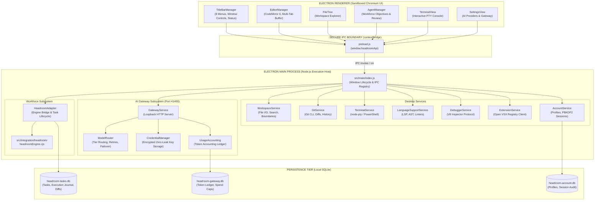

# HEADROOM IDE — ARCHITECTURE SPECIFICATION

**Document Version:** 1.0.0 (Release Acceptance Baseline)  
**Product:** HEADROOM — AI Development Operating System  
**Repository:** `D:\codex room\IDE`  
**Authoritative Backend:** `D:\codex room\headroom`  
**Pure JavaScript Constraint:** 100% Pure JavaScript (0 TypeScript / TSX files across codebase)

---

## 1. EXECUTIVE SUMMARY

HEADROOM is an AI Development Operating System packaged as a standalone desktop IDE for Windows. Inspired by the refined layout and interaction model of Antigravity IDE, HEADROOM pairs a high-performance desktop editor with an enterprise-grade multi-agent autonomous workforce.

Unlike conventional editor extensions, HEADROOM runs as a sovereign desktop operating environment. It strictly enforces process isolation between an unprivileged sandboxed Electron Renderer and an audited, capability-restricted Electron Main process.

---

## 2. SYSTEM TOPOLOGY & PROCESS BOUNDARIES

---

## 3. SUBSYSTEM ARCHITECTURE & IMPLEMENTATION STATUS

### 3.1 Desktop Shell & Title Bar
- **Implementation Status:** `VERIFIED`
- **Location:** `src/renderer/js/titlebar/titleBarManager.js`, `src/renderer/css/layout.css`
- **Architecture:** Pure JavaScript DOM manager without virtual DOM runtime overhead. Features:
  - 8-menu cluster (`File`, `Edit`, `Selection`, `View`, `Go`, `Run`, `Terminal`, `Help`) wired to actual commands.
  - Absolute centered workspace title (`left: 50%; transform: translateX(-50%)`) displaying active workspace, file path, and persistent unsaved-changes bullet (`•`).
  - Layout toolbar buttons (`Split`, `Sidebar`, `Bottom`, `Agent Panel`, `Layout Settings`) with `aria-pressed` synchronization.
  - Real-time connection indicator and live workforce active agent count badge.
  - Native window controls (Minimize, Maximize/Restore, Close) synchronized via Electron `onMaximizedChange`.

### 3.2 Editor & Code Workspace
- **Implementation Status:** `VERIFIED`
- **Location:** `src/renderer/js/editor/editorManager.js`
- **Architecture:** CodeMirror 6 with dynamic language syntax highlighting (JavaScript, Markdown, JSON, HTML, CSS), multi-tab buffer management, dirty-document tracking, conflict detection, and file formatting.

### 3.3 Authoritative AI Workforce Engine
- **Implementation Status:** `VERIFIED`
- **Location:** `D:\codex room\headroom`, `src/main/services/HeadroomAdapter.js`, `src/integration/headroom/headroomEngine.cjs`
- **Architecture:** The authoritative backend engine orchestrates specialized agent departments (Engineering, QA, Product, Architecture). The desktop IDE communicates via `HeadroomAdapter.js`, which binds directly to the engine bundle and records execution journals, diffs, tool activity, and task status into a local SQLite database (`headroom-tasks.db`).

### 3.4 Provider-Neutral AI Gateway
- **Implementation Status:** `VERIFIED`
- **Location:** `src/main/services/gateway/`
- **Architecture:** Local loopback server (`http://127.0.0.1:41400`) providing OpenAI-compatible endpoints. Features:
  - **ModelRegistry**: Metadata, provider capabilities, and pricing provenance.
  - **ModelRouter**: Deterministic routing strategies (`economy`, `quality`, `balanced`, `fast`), cascading fallback, and exponential backoff retries.
  - **CredentialManager**: Zero-leak storage of OpenAI, Anthropic, Gemini, and custom API keys. Plaintext keys never leave the main process; UI receives masked representations.
  - **UsageAccounting**: Token ledger calculating input/output token costs across tasks with per-task spend caps.

### 3.5 Language Tooling & Debugging
- **Implementation Status:** `VERIFIED`
- **Location:** `src/main/services/LanguageSupportService.js`, `src/main/services/DebuggerService.js`
- **Architecture:**
  - 6-tier language capability matrix discovering host toolchains (Node.js, Python, Rust, Go, C++, Java).
  - Real syntax diagnostics extracted via host compilers/linters.
  - Node.js runtime process execution and streaming output capture.
  - Real debugger lifecycle implementing the Node.js V8 Inspector Protocol via WebSocket (`ws://127.0.0.1:<port>`).

### 3.6 Terminal & Shell Execution
- **Implementation Status:** `VERIFIED`
- **Location:** `src/main/services/TerminalService.js`, `src/renderer/js/terminal/terminalView.js`
- **Architecture:** Manages PTY sessions using PowerShell on Windows, with ANSI color streaming, resize events, and process lifecycle cleanup.

### 3.7 Extension & Marketplace System
- **Implementation Status:** `VERIFIED`
- **Location:** `src/main/services/ExtensionService.js`, `src/renderer/js/extensions/extensionView.js`
- **Architecture:** Live Open VSX Registry client supporting search, pagination, manifest validation, zip-slip path traversal prevention, and local installation audits.

### 3.8 Account & Session Security
- **Implementation Status:** `VERIFIED`
- **Location:** `src/main/services/AccountService.js`, `src/renderer/js/account/`
- **Architecture:** Local profile management, PBKDF2 password hashing with salt, session token generation with configurable inactivity lock (default 30 min), hardware device fingerprinting, and audit logging.

---

## 4. DATA FLOWS & IPC CONTRACTS

### 4.1 Invocation Protocol
All renderer-to-main communication uses strictly authorized IPC channels registered in `src/main/index.js` and exposed in `src/main/preload.js`:

| IPC Channel | Direction | Purpose | Parameter Validation |
| :--- | :--- | :--- | :--- |
| `workspace:open-file-dialog` | Request-Response | Prompts native OS file picker | None (native dialog) |
| `workspace:read-file` | Request-Response | Reads file contents | Validates canonical path within workspace bounds |
| `workspace:write-file` | Request-Response | Flushes editor buffer to disk | Enforces write permissions & path boundaries |
| `headroom:create-task` | Request-Response | Submits agent workforce objective | Validates prompt string & options |
| `headroom:execute-task` | Request-Response | Executes task through workforce | Validates task ID existence |
| `gateway:chat-completions` | Request-Response | Proxies LLM prompt through router | Validates model & message array |
| `terminal:create` | Request-Response | Spawns PTY session | Resolves working directory |
| `window:maximize` | Request-Response | Toggles native maximize/restore | Validates target window liveness |

### 4.2 Event Streaming Protocol
Long-running operations (workforce progress, terminal PTY output, debugger events) stream updates from Main to Renderer using unidirectional events:
- `terminal:data` (PTY stdout/stderr stream)
- `headroom:task-update` (agent progress, tool activity)
- `debugger:paused` / `debugger:resumed` (V8 Inspector events)
- `window:maximized-change` (window state synchronization)

---

## 5. TRUST BOUNDARIES & SECURITY POLICIES

1. **Renderer Sandbox Boundary:**
   - `nodeIntegration: false`, `contextIsolation: true`, `sandbox: true`.
   - The renderer cannot require Node.js built-ins or execute shell commands directly.
2. **Filesystem Canonicalization Boundary:**
   - All filesystem operations in `WorkspaceService` resolve symlinks and verify paths against the active workspace boundary to prevent path traversal (`../../`).
3. **Loopback Network Isolation:**
   - The AI Gateway server listens strictly on `127.0.0.1:41400`. External network exposure is rejected.
   - SSRF protection blocks cloud metadata IP addresses (`169.254.169.254`, `metadata.google.internal`).
4. **Secret Redaction & Storage:**
   - API keys stored in `CredentialManager` are never returned in plaintext to the UI.
   - Logs and error traces scrub strings matching known key formats (`sk-...`, `AIzaSy...`).
5. **Zero-TypeScript Pure JavaScript Mandate:**
   - 100% pure JavaScript across the codebase. Enforced automatically by `scripts/quality-gate.js check-ts`.
